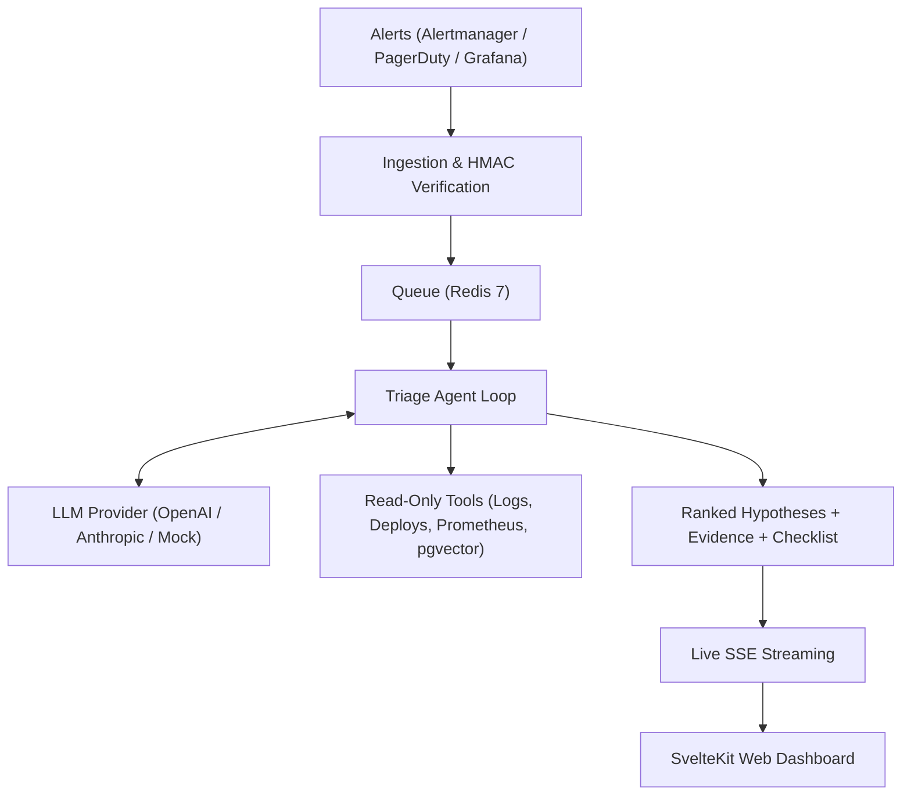

# Ayin (ዓይን) 👁️
> *Ayin* (ዓይን) — meaning **"Eye"** in Amharic. An autonomous, multi-tenant incident triage & observability agent that ingests alerts and logs, investigates with read-only tools, and returns ranked root-cause hypotheses with verified evidence, confidence, and first-response checklists.

[](https://github.com/triage-agent/triage/actions)
[](https://opensource.org/licenses/MIT)

---

## Quickstart in 5 Commands

```bash
# 1. Clone repository
git clone https://github.com/triage-agent/triage.git && cd triage

# 2. Configure environment
cp .env.example .env

# 3. Build Go binaries and web assets
make build

# 4. Run test suites
make test

# 5. Launch local development environment
make dev
```

Visit the dashboard at [http://localhost:3000](http://localhost:3000) or check the API health at [http://localhost:8080/healthz](http://localhost:8080/healthz).

---

## Architecture Overview



---

## Monorepo Layout

```text
triage/
├── apps/
│   ├── api/                          # Go backend (Chi, pgx, sqlc, slog)
│   │   ├── cmd/
│   │   │   ├── api/                  # HTTP API server entry
│   │   │   ├── worker/               # Async job worker
│   │   │   ├── eval/                 # Evaluation CLI runner
│   │   │   ├── simulate/             # Fault-injection generator
│   │   │   ├── mcp/                  # Model Context Protocol server
│   │   │   └── triage/               # Cobra CLI client
│   │   ├── internal/
│   │   │   ├── config/               # Validated env configuration
│   │   │   ├── server/               # Router, health probes, middleware
│   │   │   └── telemetry/            # Slog JSON logging & metrics
│   │   ├── Dockerfile
│   │   └── go.mod
│   └── web/                          # SvelteKit frontend (TypeScript, Tailwind 4, Svelte 5 runes)
├── api/
│   └── openapi.yaml                  # OpenAPI 3.1 Contract
├── deploy/
│   ├── docker-compose.yml            # PostgreSQL(pgvector), Redis, Prometheus, Grafana
│   └── prometheus/
├── docs/
│   ├── developer-guide.md            # Integration guide (GitHub, GitLab, Alerts, MCP)
│   ├── architecture.md               # System design & core tenets
│   └── decisions/                    # Architecture Decision Records (ADRs)
├── Makefile
├── .env.example
└── README.md
```

---

## Development Commands

| Command | Action |
| :--- | :--- |
| `make dev` | Start full stack via docker-compose |
| `make test` | Run Go test suites and SvelteKit unit tests |
| `make lint` | Run Go vet and SvelteKit type checks |
| `make build` | Compile all 6 Go binaries and build web frontend |
| `make eval` | Execute scenario evaluation harness |
| `make simulate` | Trigger fault-injection simulator |
| `make gen` | Sync SvelteKit and OpenAPI bindings |
