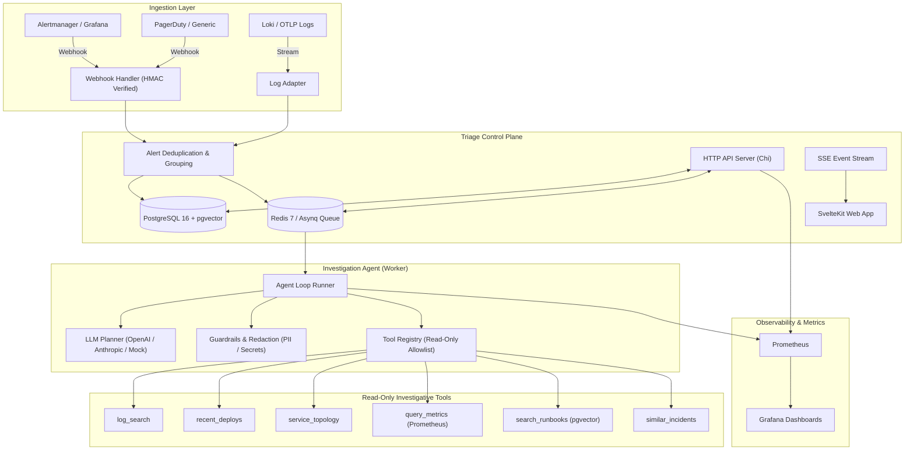

# Architecture & System Design

`triage` is an autonomous, multi-tenant incident triage agent designed for cloud-native engineering organizations. It ingests alerts and logs, deploys read-only investigative tools, formulates and scores root-cause hypotheses with concrete evidence links, and generates actionable first-response checklists.

## High-Level Architecture Diagram

## Core Tenets

1. **Safety First**: The investigative agent operates strictly within a read-only tool allowlist. It is physically incapable of mutating infrastructure during triage. Remediations are strictly proposed (never executed directly) and require human-in-the-loop responder approval.
2. **Multi-Tenancy from Day One**: Every database entity is partitioned by `org_id`, enforced via PostgreSQL Row-Level Security (RLS) with session settings (`SET LOCAL app.org_id`).
3. **Evidence-Linked Hypotheses**: Hypotheses produced by the LLM planner are rejected unless backed by traceable, non-hallucinated run steps and evidentiary excerpts.
4. **Deterministic Evaluation**: Every prompt change or agent iteration is continuously scored across 15 benchmark scenarios via automated evaluation CLI (`cmd/eval`), gating regressions in CI.
